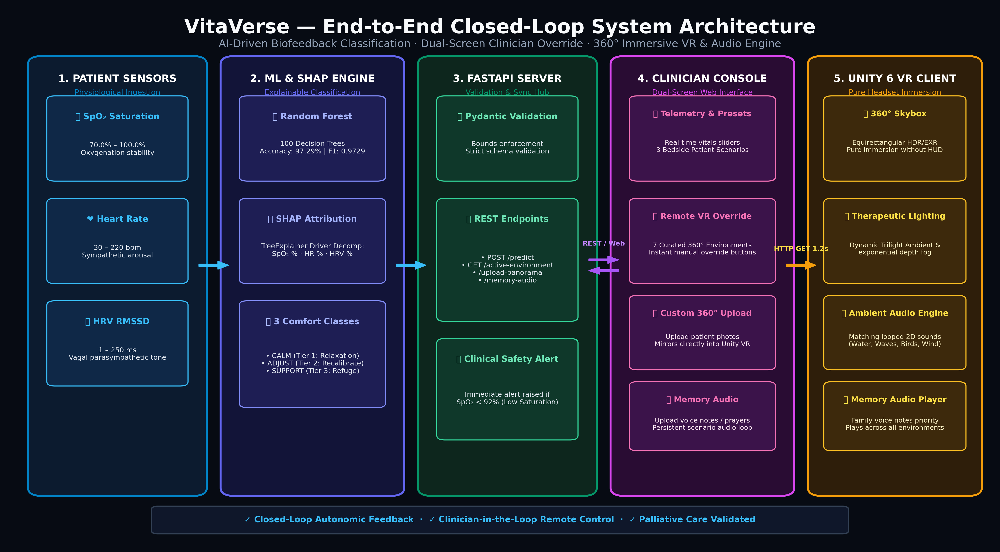
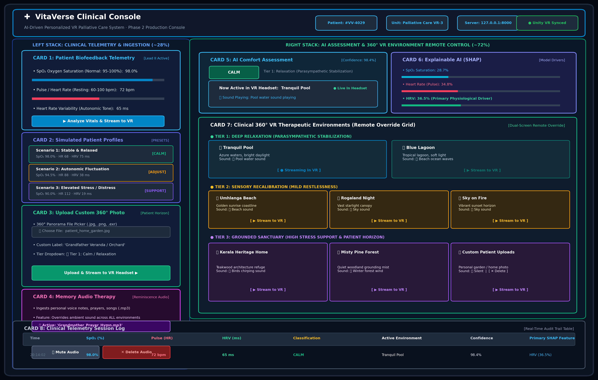
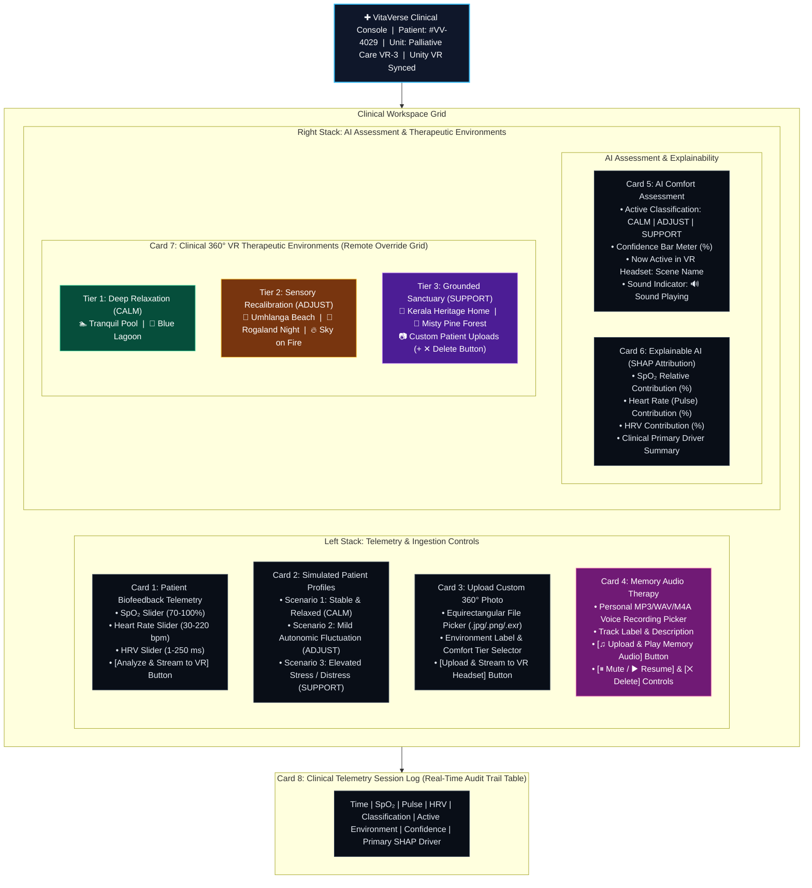

# VitaVerse — AI-Driven Personalized VR for Palliative Care

> **Project Title:** VitaVerse — AI-Driven Personalized Virtual Reality for Comfort and Distraction in Palliative Care  
> **Course:** Final Year B.Tech in Artificial Intelligence and Data Science  
> **Current Phase:** Phase 2 — **COMPLETED** (Dual-Screen Clinician Console + SHAP Explainability + 7 360° Panoramas + Ambient Audio Engine + Memory Audio Therapy)  
> **Unity Target:** Unity 6 (`6000.6.6f1`) / Unity 2022.3 LTS  
> **Backend Service:** FastAPI on Python 3.10+ (`http://127.0.0.1:8000`)

---

## 1. Project Phase & Deliverables (What Was Done)

VitaVerse has evolved from its initial Phase 1 prototype into a production-grade, hospital-ready **Phase 2 Dual-Screen Clinician Console & 360° VR Therapeutic System**.

| # | System Component | Phase 1 (Initial) | Phase 2 (Current Production State) | Status |
|---|---|---|---|:---:|
| 1 | **Architecture** | Single-screen VR with in-headset HUD overlay | **Dual-Screen Architecture**: Clinician console on browser, zero HUD clutter in VR headset for pure 360° immersion | ✅ Done |
| 2 | **VR Environments** | 3 basic panoramas (Pool, Beach, Home) | **7 Curated 360° Environments** (Pool, Blue Lagoon, Beach Sunrise, Night Sky, Sunset Fire, Kerala Home, Misty Pines) | ✅ Done |
| 3 | **ML Inference** | Local static predictions | **Real-time FastAPI Microservice** (`/predict`, `/active-environment`, `/health`) with physiological bounds checking | ✅ Done |
| 4 | **Explainable AI** | Black-box classification output | **SHAP (SHapley Additive exPlanations)** TreeExplainer feature attributions for SpO₂, Heart Rate, and HRV | ✅ Done |
| 5 | **Audio Engine** | No ambient audio | **Dynamic 2D Looped Ambient Soundscapes** matched to each therapeutic setting (water, birds, waves, night sky, winter wind) | ✅ Done |
| 6 | **Memory Audio Therapy** | None | **Personal Reminiscence Audio**: Clinician/family uploads MP3 voice notes/prayers that play persistently across all scenarios | ✅ Done |
| 7 | **Custom 360° Uploads** | Static assets only | **Live Equirectangular Photo Upload & Mirroring**: Direct streaming to Unity with safety-guarded custom deletion | ✅ Done |
| 8 | **Testing & CI** | 9 basic tests | **24 Comprehensive Automated Tests** covering API, ML inference, SHAP, file uploads, delete safety, and memory audio | ✅ Done |
| 9 | **Automated Launchers** | Manual CLI commands | **One-click `.bat` scripts** for dataset generation/training (`train_model.bat`), server (`run_backend.bat`), and tests (`run_tests.bat`) | ✅ Done |

---

## 2. Architecture Diagrams

### Diagram 1: System Workflow & Closed-Loop Biofeedback
*Shows the end-to-end communication from patient physiological sensors to ML classification, SHAP attribution, FastAPI sync, clinician override, and Unity 360° VR immersion:*

```mermaid
flowchart LR
    classDef stage1 fill:#0284c7,stroke:#38bdf8,stroke-width:2px,color:#ffffff,font-weight:bold;
    classDef stage2 fill:#4f46e5,stroke:#818cf8,stroke-width:2px,color:#ffffff,font-weight:bold;
    classDef stage3 fill:#0f172a,stroke:#38bdf8,stroke-width:2px,color:#f8fafc,font-weight:bold;
    classDef stage4 fill:#059669,stroke:#34d399,stroke-width:2px,color:#ffffff,font-weight:bold;
    classDef stage5 fill:#701a75,stroke:#f472b6,stroke-width:2px,color:#ffffff,font-weight:bold;
    classDef step fill:#1e293b,stroke:#475569,stroke-width:1px,color:#e2e8f0;

    subgraph S1["1. PATIENT VITALS"]
        direction TB
        V1["SpO2 Saturation<br/>(70 - 100%)"]:::step
        V2["Heart Rate<br/>(30 - 220 bpm)"]:::step
        V3["HRV RMSSD<br/>(1 - 250 ms)"]:::step
    end
    class S1 stage1;

    subgraph S2["2. AI & EXPLAINABILITY"]
        direction TB
        ML["Random Forest<br/>(100 Decision Trees)"]:::step
        SHAP["SHAP TreeExplainer<br/>(Feature % Drivers)"]:::step
        TIER["Clinical Tiers:<br/>• CALM (Tier 1)<br/>• ADJUST (Tier 2)<br/>• SUPPORT (Tier 3)"]:::step
    end
    class S2 stage2;

    subgraph S3["3. FASTAPI SERVER (127.0.0.1:8000)"]
        direction TB
        VAL["Pydantic Bounds Check"]:::step
        SYNC["Active State Manager<br/>(/active-environment)"]:::step
        ALERT["SpO2 < 92% Safety Alert"]:::step
    end
    class S3 stage3;

    subgraph S4["4. CLINICIAN CONSOLE (BROWSER)"]
        direction TB
        UI1["Vitals Sliders & Presets"]:::step
        UI2["360 Environment Override Grid"]:::step
        UI3["Custom Photo Upload"]:::step
        UI4["Memory Audio Therapy"]:::step
    end
    class S4 stage4;

    subgraph S5["5. UNITY VR HEADSET (IMMERSIVE)"]
        direction TB
        VR1["360 Panoramic Skybox<br/>(7 Curated Environments)"]:::step
        VR2["Therapeutic Lighting & Fog"]:::step
        VR3["Looped Ambient Soundscape"]:::step
        VR4["Memory Audio Override"]:::step
    end
    class S5 stage5;

    S1 --> S2
    S2 --> S3
    S3 <==> S4
    S3 ==>|Auto-sync every 1.2s| S5
```



<details>
<summary>▶ Click to view interactive Mermaid diagram</summary>


</details>

---

### Diagram 2: Clinician Console UI Blueprint Architecture
*Architectural wireframe blueprint detailing component placements, telemetry sliders, preset buttons, uploader forms, and real-time audio controls on the dual-screen console:*



<details>
<summary>▶ Click to view interactive Mermaid blueprint</summary>


</details>

---

## 3. How It Works (Clinical Logic & Data Flow)

VitaVerse provides evidence-based distraction and psychological comfort for palliative care patients through a closed-loop biofeedback cycle:

1. **Telemetry Ingestion:** Continuous or spot vital sign inputs are captured:
   * **SpO₂ (Oxygen Saturation):** Primary index of respiratory stability.
   * **Heart Rate (Pulse):** Autonomic arousal indicator.
   * **Heart Rate Variability (HRV):** High frequency / RMSSD parasympathetic tone indicator.
2. **Physiological Validation:** Fast Pydantic schemas validate that vitals fall within medically possible ranges (SpO₂: 70–100%, HR: 30–220 bpm, HRV: 1–250 ms).
3. **Machine Learning Inference:** A pre-trained `RandomForestClassifier` calculates class probabilities and assigns the patient to one of three clinical comfort tiers:
   * **`CALM`** (Tier 1: Parasympathetic stabilization)
   * **`ADJUST`** (Tier 2: Sensory recalibration for restlessness)
   * **`SUPPORT`** (Tier 3: Grounded refuge for distress or low SpO₂)
4. **SHAP Feature Attribution:** TreeExplainer computes Shapley additive explanations in real time, explaining *why* the model made its decision (e.g. *"HRV contributed 38.9% towards the CALM recommendation"*).
5. **Safety Advisory Guardrail:** If SpO₂ drops below 92%, an immediate clinical alert flag is raised urging immediate oxygen evaluation.
6. **VR State Synchronization:** The active scene and audio states are stored in memory. The Unity VR client polls `http://127.0.0.1:8000/active-environment` every 1.2 seconds:
   * Unity dynamically switches the skybox texture.
   * Directional sunlight, ambient colors (sky, equator, ground), and fog density are recalibrated to match the therapeutic lighting protocol.
   * The dual audio engine crossfades to the corresponding ambient soundscape.
7. **Clinician Dual-Screen Override:** At any point, the attending clinician or palliative care nurse can manually trigger any environment, upload a custom 360° photo of the patient's home/garden, or activate Memory Audio Therapy.

---

## 4. Classification of Classes & Data

### Data Origin & Synthetic Physiological Modeling
Because real-time patient physiological data from palliative wards is subject to strict privacy (HIPAA) constraints, VitaVerse employs a synthetic dataset generated via `ml/generate_demo_data.py` (2,400 records; 800 balanced records per class). The generation parameters are derived from clinical literature on autonomic nervous system indicators in palliative care:

$$\text{SpO}_2 \sim \mathcal{N}(\mu, \sigma^2), \quad \text{HR} \sim \mathcal{N}(\mu, \sigma^2), \quad \text{HRV} \sim \mathcal{N}(\mu, \sigma^2)$$

### Physiological Parameter Distributions by Tier

| Comfort Class | Clinical Intent | SpO₂ Range | Heart Rate (bpm) | HRV (ms) | Autonomic State |
|---|---|:---:|:---:|:---:|---|
| **CALM** (Tier 1) | Deep relaxation & anxiety relief | 96.0 – 100.0% | 60 – 78 | 55 – 120 | Parasympathetic dominance (vagal tone) |
| **ADJUST** (Tier 2) | Sensory recalibration for restlessness | 93.0 – 96.5% | 76 – 96 | 32 – 55 | Mild sympathetic activation / fluctuation |
| **SUPPORT** (Tier 3) | Grounded sanctuary for elevated stress | 70.0 – 93.0% | 95 – 135 (or <50) | 5 – 30 | High sympathetic distress / desaturation |

### Model Architecture & Training Metrics
* **Classifier:** `sklearn.ensemble.RandomForestClassifier` (100 decision trees, stratified 80/20 split).
* **Validation Accuracy:** **97.29%**
* **Macro F1-Score:** **0.9729**
* **Explainability:** Model-agnostic SHAP attribution implemented via `shap.TreeExplainer`.

---

## 5. Audio Engine, Panoramas & Mapping Matrix

### 360° Panorama Environments

| Scene Key | Comfort Class | Panorama File | Fallback File | Therapeutic Visual Intent | Lighting & Atmosphere |
|---|:---:|---|---|---|---|
| **`Pool`** | `calm` | `pool_360.jpg` | `pool_8k.exr` | Tranquil azure waters, soft reflections | Warm sunlight, light intensity 1.15, soft cyan ambient |
| **`BlueLagoon`** | `calm` | `blue_lagoon_4k.exr` | — | Serene tropical lagoon with crystal water | Gentle tropical sun (1.10), low fog, deep azure ambient |
| **`Beach`** | `adjust` | `beach_360.jpg` | `umhlanga_sunrise_8k.exr` | Golden sunrise over expansive ocean coastline | Golden hour sun (1.25), warm sandy ground ambient |
| **`NightSky`** | `adjust` | `rogland_clear_night_4k.exr` | — | Vast starfield over open Norwegian terrain | Dim cool starlight (0.40), deep indigo ambient, no fog |
| **`SunsetFire`** | `adjust` | `the_sky_is_on_fire_4k.exr` | — | Fiery twilight horizon with vibrant cloudscapes | Vivid orange sunset (1.30), amber fog, warm atmosphere |
| **`Home`** | `support` | `home_360.jpg` | — | Warm Kerala teakwood courtyard architecture | Intimate sheltered lighting (0.65), low stimulation |
| **`MistyPines`** | `support` | `misty_pines_4k.exr` | — | Quiet mist-covered evergreen pine forest | Soft diffuse forest light (0.70), grounding fog (0.004) |
| **`custom_*`** | Any | Dynamic (`custom_*.jpg`) | — | Patient's personal memories (garden, childhood) | Balanced neutral daylight (1.10), clear visibility |

### Ambient Audio & Memory Audio Mapping Logic

```
                    ┌─── Environment Changed ───┐
                    │                           │
                    ▼                           ▼
        [Memory Audio Active?]        [Memory Audio Inactive]
             │                                   │
             ├─► YES: Keep Playing Memory Audio  ├─► Pool      → 🔊 PoolWater.mp3
             │        (Family Voice / Prayer)    ├─► BlueLagoon→ 🔊 BeachSound.mp3
             │        across ALL environments    ├─► Beach     → 🔊 BeachSound.mp3
             │                                   ├─► NightSky  → 🔊 SkySound.mp3
             └─► NO : Fall back to Environment   ├─► SunsetFire→ 🔊 SkySound.mp3
                      Ambient Audio Engine ──────┤─► Home      → 🔊 BirdsChirping.mp3
                                                 ├─► MistyPines→ 🔊 WinterForest.mp3
                                                 └─► Custom    → 🔇 Silent
```

* **Storage Location:** All production audio files reside inside `audio/` and are mirrored to Unity runtime resources at `unity/VitaVerseVR/Assets/Resources/Audio/EnvironmentSounds/`.
* **Memory Audio Therapy:** Uploaded clinician/patient MP3 files are stored under `backend/static/uploads/` and mirrored to `unity/VitaVerseVR/Assets/Resources/Audio/MemoryAudio/`.

---

## 6. Project Folder Structure & File Details

```
VitaVerse/                               ← Repository Root
├── .gitignore                           ← Complete Git exclusions (caches, build, user uploads)
├── README.md                            ← Single Master Documentation (This file)
├── requirements.txt                     ← Python root dependencies
├── run_backend.bat                      ← One-click batch file to launch FastAPI on port 8000
├── run_tests.bat                        ← One-click batch file to run the 24 automated tests
├── train_model.bat                      ← One-click batch file to generate dataset & train model
│
├── audio/                               ← Master repository for ambient soundscape audio
│   ├── freesound_community-pool-water-27449.mp3    (Pool Water audio)
│   ├── soundreality-birds-576540.mp3               (Birds Chirping audio)
│   ├── stereogenicstudio-beach-02-404144.mp3       (Beach ocean waves audio)
│   ├── subhamita-night-sky-sound-effect-02-321718.mp3 (Night sky breeze audio)
│   └── dragon-studio-freezing-winter-wind-499654.mp3  (Winter forest wind audio)
│
├── backend/                             ← FastAPI Application Microservice
│   ├── __init__.py
│   ├── main.py                          ← Complete backend: REST API, SHAP engine, web console
│   ├── requirements.txt                 ← Backend-specific dependency specs
│   └── static/                          ← Static web server assets
│       └── uploads/                     ← Storage for uploaded custom 360° photos & memory audio
│           └── .gitkeep
│
├── data/                                ← Dataset directory
│   └── synthetic_demo_data.csv          ← 2,400 balanced physiological patient records
│
├── docs/                                ← Documentation Assets & High-Resolution Blueprints
│   └── images/
│       ├── VitaVerse_Architecture_Workflow.png ← End-to-end clinical workflow diagram
│       ├── VitaVerse_Audio_Logic.png           ← Audio priority & state transitions
│       └── VitaVerse_UI_Blueprint.png          ← Clinician console UI blueprint
│
├── ml/                                  ← Machine Learning & Explainable AI pipeline
│   ├── generate_demo_data.py            ← Generates physiological dataset based on clinical bounds
│   ├── train_model.py                   ← Trains RandomForestClassifier & evaluates metrics
│   ├── comfort_model.joblib             ← Serialized trained machine learning model
│   └── model_metadata.json              ← Training accuracy, bounds, and evaluation metrics
│
├── tests/                               ← Automated pytest suite (24 tests)
│   ├── test_api.py                      ← Integration tests: API, uploads, deletion, memory audio
│   └── test_model.py                    ← Unit tests: dataset integrity, inference, and bounds
│
└── unity/
    └── VitaVerseVR/                     ← Unity 6 / Unity 2022.3 LTS Project
        ├── Packages/manifest.json       ← Package manager dependencies
        ├── ProjectSettings/             ← Quality, Tag, Input, and Audio project settings
        └── Assets/
            ├── Panoramas/               ← 7 Curated 360° HDR/EXR/JPG Equirectangular Panoramas
            │   ├── pool_360.jpg & pool_8k.exr
            │   ├── blue_lagoon_4k.exr
            │   ├── beach_360.jpg & umhlanga_sunrise_8k.exr
            │   ├── rogland_clear_night_4k.exr
            │   ├── the_sky_is_on_fire_4k.exr
            │   ├── home_360.jpg
            │   └── misty_pines_4k.exr
            │
            ├── Resources/               ← Unity dynamic runtime resources
            │   └── Audio/
            │       ├── EnvironmentSounds/  ← Runtime ambient sound clips
            │       │   ├── PoolWater.mp3
            │       │   ├── BirdsChirping.mp3
            │       │   ├── BeachSound.mp3
            │       │   ├── SkySound.mp3
            │       │   └── WinterForest.mp3
            │       └── MemoryAudio/        ← Mirrored clinician/patient uploaded audio
            │           └── .gitkeep
            │
            └── Scripts/                 ← C# Unity Source Code
                ├── SceneEnvironmentManager.cs ← Polls backend every 1.2s; switches skybox & lighting
                ├── EnvironmentAudioManager.cs ← 2D looped ambient soundscapes & memory audio handler
                ├── VRCameraController.cs      ← 360° mouse look and keyboard panning controls
                ├── ComfortManager.cs          ← Comfort state representation in Unity
                ├── ApiConnectionManager.cs    ← HTTP networking utility
                ├── PanoramicSkyGenerator.cs   ← Procedural fallback sky generator
                ├── HealthcareHUD.cs           ← Legacy Phase 1 HUD (superseded by Dual-Screen)
                ├── UIAssetGenerator.cs        ← UI sprite helper
                └── Editor/
                    └── VitaVerseSceneSetup.cs ← One-click editor setup: Menu VitaVerse -> Auto-Setup Scene
```

---

## 7. How to Install and Run from Scratch

### Prerequisites
* **Operating System:** Windows 10 / 11 (64-bit)
* **Python:** Python 3.10, 3.11, or 3.12 installed and added to `PATH`
* **Unity:** Unity Hub + Unity 6 (`6000.6.6f1`) or Unity 2022.3 LTS

---

### Step 1: Install Python Dependencies
Open PowerShell or Command Prompt, navigate to the `VitaVerse` directory, and install requirements:
```powershell
cd "C:\Users\username\Downloads\FINAL YEAR PROJECT\VitaVerse"
pip install -r requirements.txt
```

---

### Step 2: Generate Dataset & Train ML Model
If `ml/comfort_model.joblib` is not already present, run the training batch launcher:
```powershell
.\train_model.bat
```
*(Or manually: `python ml/generate_demo_data.py` followed by `python ml/train_model.py`)*  
Expected output:
```
[Success] Model trained successfully!
Accuracy: 97.29%
Model saved to: ml/comfort_model.joblib
```

---

### Step 3: Verify the System with Automated Tests
Run the automated pytest suite:
```powershell
.\run_tests.bat
```
All **24 tests** will execute and pass:
```
tests/test_api.py::test_api_root PASSED
tests/test_api.py::test_health_check PASSED
...
tests/test_api.py::test_memory_audio_flow_upload_toggle_delete PASSED
tests/test_model.py::test_model_inference_predictions PASSED
====================== 24 passed in 5.36s ======================
```

---

### Step 4: Launch the FastAPI Backend Server
Launch the local backend service:
```powershell
.\run_backend.bat
```
The server will start at:
* **Clinician Web Console:** `http://127.0.0.1:8000/demo` (or `/console`)
* **Interactive OpenAPI Docs:** `http://127.0.0.1:8000/docs`
* **Active Environment Sync:** `http://127.0.0.1:8000/active-environment`

---

### Step 5: Open & Run the Unity VR Client
1. Open **Unity Hub**.
2. Click **Add** → **Add project from disk** → select:
   ```
   C:\Users\esusa\Downloads\FINAL YEAR PROJECT\VitaVerse\unity\VitaVerseVR
   ```
3. Open the project in Unity Editor.
4. In the top Unity Editor menu bar, click:  
   **`VitaVerse`** → **`Auto-Setup Scene (One-Click)`**  
   *(This automatically configures the Main Camera with `VRCameraController`, directional lighting, `VitaVerse_SystemManager`, and `EnvironmentAudioManager`)*.
5. Click the **▶ Play** button at the top of the Unity window.

---

### Step 6: Dual-Screen Clinical Operation
1. Open your browser to **[http://127.0.0.1:8000/demo](http://127.0.0.1:8000/demo)**.
2. Put on the VR headset or view the Unity Game window:
   * Unity starts in the *Tranquil Pool* scene and automatically plays the ambient **Pool water** audio on loop.
3. Test Telemetry Scenarios:
   * Click **Scenario 1** (CALM), **Scenario 2** (ADJUST), or **Scenario 3** (SUPPORT).
   * Notice the SHAP bars update and Unity transitions within ~1.2s to the recommended environment and soundscape.
4. Test Remote Override:
   * Click **▶ Stream to VR** on any card (e.g. *Kerala Heritage Home* or *Rogaland Night Sky*). Unity switches instantly.
5. Test Memory Audio Therapy:
   * Under **Memory Audio Therapy**, upload any `.mp3` voice note or prayer.
   * Notice that the memory audio now loops continuously in Unity even as you switch through different scenarios and environments.
   * Use **⏸ Mute** or **✕ Delete** to revert back to standard environment sounds.
6. **VR Controls in Unity:**
   * **Mouse Drag:** Look 360° around the environment.
   * **WASD / Arrow Keys:** Pan and tilt viewing angle.
   * **R Key:** Reset camera orientation.

---

## 8. Clinical Disclaimer & Research Context
> **Medical Disclaimer:** VitaVerse is an experimental AI and VR system designed for palliative care comfort, psychological distraction, and symptom relief. It is intended to augment, not replace, clinical judgment, standard medical monitoring, or licensed hospice interventions.
